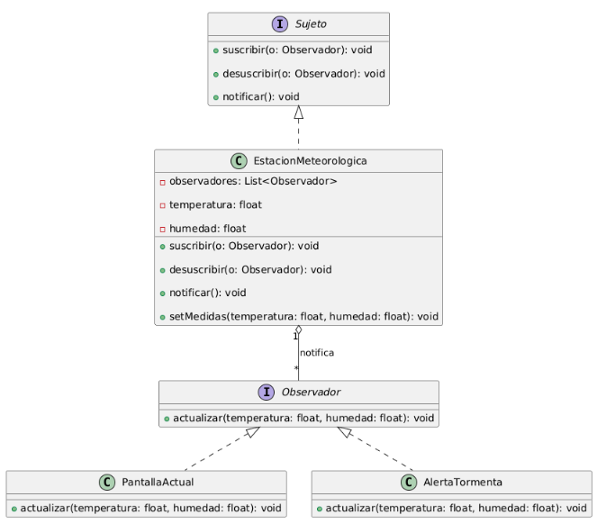

# Patrón de diseño Observer (Java)

Exposición de patrones de diseño. ISW-2, Sesión 19. Grupo 3.

**Integrantes:**
- Yonnatan Gonzalez Ochoa
- Juan Pablo Moreno Castro
- Maria Valentina Osorio Romero
- Santiago Rojas Galeano

## ¿Qué es el patrón Observer?

Observer es un patrón de **comportamiento** que define una dependencia uno a muchos entre objetos: cuando un objeto (el **sujeto**) cambia de estado, todos sus dependientes (los **observadores**) son notificados y se actualizan automáticamente.

**Problema que resuelve:** evita que los objetos consulten constantemente al sujeto si cambió algo (polling) y evita que el sujeto tenga referencias directas a cada interesado (acoplamiento).

**Cuándo usarlo:**
- Un cambio en un objeto debe actualizar a otros y no se sabe cuántos son de antemano.
- Los objetos deben poder suscribirse y desuscribirse en tiempo de ejecución.
- Se busca bajo acoplamiento entre quien emite un evento y quien reacciona.

## Estructura UML



| Participante | Rol |
|---|---|
| `Sujeto` | Interfaz con `suscribir`, `desuscribir` y `notificar` |
| `Observador` | Interfaz con el método `actualizar` |
| `EstacionMeteorologica` | Sujeto concreto: guarda el estado y la lista de observadores |
| `PantallaActual` | Observador concreto: muestra los valores |
| `AlertaTormenta` | Observador concreto: alerta si humedad > 80 y temperatura < 18 |

## Estructura del proyecto

```
observer-patron/
├── README.md
├── docs/
│   └── uml-observer.png
└── src/
    ├── observer/
    │   ├── Sujeto.java
    │   └── Observador.java
    ├── codejava/
    │   ├── EstacionMeteorologica.java
    │   ├── PantallaActual.java
    │   └── AlertaTormenta.java
    └── main/
        └── Main.java
```

## Requisitos

- JDK 11 o superior

## Cómo ejecutarlo

1. Clonar el repositorio:

```bash
git clone [URL-DEL-REPOSITORIO]
cd observer-patron
```

2. Compilar y ejecutar:

```bash
javac -d out src/observer/*.java src/codejava/*.java src/main/*.java
java -cp out main.Main
```

En Windows (CMD o PowerShell) los comandos son los mismos. También se puede abrir la carpeta `src` en Eclipse o IntelliJ y ejecutar `main.Main`.

## Salida esperada

```
--- Medición 1 ---
[Pantalla] Temp: 24.0°C | Humedad: 55.0%
--- Medición 2 ---
[Pantalla] Temp: 15.0°C | Humedad: 90.0%
[ALERTA] Posible tormenta, humedad alta y temperatura baja
--- Se desuscribe la alerta ---
[Pantalla] Temp: 14.0°C | Humedad: 95.0%
```

## Qué demuestra el ejemplo

1. **Medición 1:** todos los observadores reciben la notificación, pero solo la pantalla imprime (no se cumple la condición de alerta).
2. **Medición 2:** el mismo evento genera reacciones distintas: imprimen la pantalla y la alerta.
3. **Medición 3:** la alerta se desuscribió en tiempo de ejecución, así que ya no reacciona aunque los valores sí cumplirían la condición.

## Fuentes

- Head First Design Patterns, Capítulo 2 (Observer).
- [Refactoring.guru: Observer](https://refactoring.guru/es/design-patterns/observer)
- [Documentación oficial de Java](https://docs.oracle.com/en/java/)
